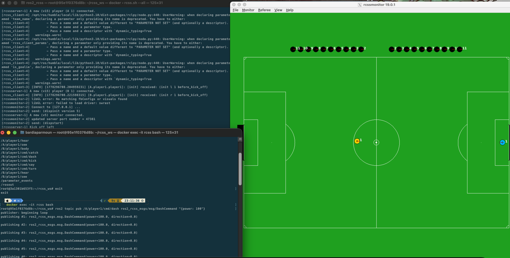

# ROS2 RCSS

<p align="center">
    
    <br>
    <em>A demo of ROS2 RCSS</em>
</p>

This is a ROS2 client for the [RoboCup Soccer Simulation 2D](https://ssim.robocup.org/).

## Installation

Compile the Docker container as follows:
```sh
$ docker build --build-arg ROS_DISTRO=${ROS_VERSION} -t rcss .
```

## Running the simulator

1. Start the Docker container
```sh
$ xhost +local:docker

$ docker run --name rcss -it \
--env DISPLAY=$DISPLAY \
--env QT_X11_NO_MITSHM=1 \
--volume /tmp/.X11-unix:/tmp/.X11-unix:rw \
--volume $HOME/.Xauthority:/root/.Xauthority:rw \
rcss
```

2. Launch the simulator inside the container
```sh
ros2 launch ros2_rcss rcss.launch.py [num_players:=] [team1:=] [team2:=] [make_goalie:=] [krislet:=] [krislet_period:=] [drop_ball_time:=]
```

3. Verify that everything is working by doing
```sh
$ ros2 topic list
/A/player1/body
/A/player1/cmd/catch
/A/player1/cmd/dash
/A/player1/cmd/kick
/A/player1/cmd/say
/A/player1/cmd/turn
/A/player1/hear
/A/player1/see
/B/player1/body
/B/player1/cmd/catch
/B/player1/cmd/dash
/B/player1/cmd/kick
/B/player1/cmd/say
/B/player1/cmd/turn
/B/player1/hear
/B/player1/see
```

## Usage

- You can echo the perception topics as follows:
```sh
$ ros2 topic echo /[team]/player[number]/body
$ ros2 topic echo /[team]/player[number]/see
$ ros2 topic echo /[team]/player[number]/hear
```

- You can publish to the action topics as follows:
```sh
$ ros2 topic pub -t 1 /[team]/player[number]/cmd/dash ros2_rcss_msgs/msg/DashCommand "{power: [value], direction: [value]}"
$ ros2 topic pub -t 1 /[team]/player[number]/cmd/turn ros2_rcss_msgs/msg/TurnCommand "{moment: [value]}"
$ ros2 topic pub -t 1 /[team]/player[number]/cmd/say ros2_rcss_msgs/msg/SayCommand "{message: [value]}"
$ ros2 topic pub -t 1 /[team]/player[number]/cmd/kick ros2_rcss_msgs/msg/KickCommand "{power: [value], direction: [value]}"
$ ros2 topic pub -t 1 /[team]/player[number]/cmd/catch ros2_rcss_msgs/msg/CatchCommand "{direction: [value]}"
```

- Each `see` object has an `object_type` (`ball`, `goal`, `flag`) and a full `name` (e.g. `ball`, `goal r`, `flag c t`).
- Each player publishes its field side (`l` or `r`) on the latched topic `/[team]/player[number]/side`.
- Before kick-off and after every goal, each player is moved to its formation position and turned to face the ball (or the centre spot after a goal). Agent commands sent while this happens are dropped.

## Starting the match programmatically (coach mode)

rcssserver waits in `before_kick_off` until someone presses *Kick Off* in the monitor; until then every player
command is dropped. With `coach:=true` (the default) the launch file starts the server with `server::coach=1`
and `server::coach_w_referee=1` (coach mode alone suspends the server's referee: a ball kicked out of bounds
stays there and no goal is judged) and starts the **referee node**, the server's one trainer (UDP port 6001):

- service `/referee/kick_off` (`std_srvs/Trigger`) sends `(change_mode play_on)`: the match starts whichever side
  the players got. `kick_off_on_start:=true` does it as soon as the node is connected, and
  `kick_off_on_command:=true` when the first command arrives from a team that Krislet does not play, so the
  clock starts when your agent acts;
- once started, whenever the referee stops play (ball out, free kick, offside, the kick-off after a goal) the
  node puts the ball back in the centre and plays on after `resume_delay_s` (1 s).

```sh
ros2 service call /referee/kick_off std_srvs/srv/Trigger
```

The server's half time is 3000 cycles (300 s at 10 cycles/s).

## Krislet baseline agent

A ROS2 port of the classic rule-based Krislet (Krzysztof Langner) strategy is included as a non-LLM baseline. It uses the same `see`/`hear`/`side` topics and `cmd/*` topics as any other agent:

1. Ball not visible → turn 40° and wait for new visual info.
2. Ball farther than 1.0 → turn to it, or dash at it if already facing it.
3. Ball kickable but opponent goal not visible → turn 40° and wait.
4. Otherwise → kick at full power towards the opponent goal.

Choose which team(s) Krislet controls and how often it decides (seconds between decisions; larger = slower):
```sh
# From the docker script: starts the match in this terminal (Ctrl-C stops it and the container)
$ ./rcss.sh --run --krislet both --krislet-period 0.5     # none | team1 | team2 | both
$ ./rcss.sh --run --krislet team1 drop_ball_time:=100   # rcssserver's own 10 s ball drop (default here: 500 cycles = 50 s)
$ ./rcss.sh --run --krislet team1 num_players:=3          # extra name:=value args go to the launch file
$ ./rcss.sh --run                                         # starts the match without Krislet
$ ./rcss.sh --run --krislet both --no-launch              # only open a shell; launch manually

# Or directly at launch time (overrides the docker script values)
$ ros2 launch ros2_rcss rcss.launch.py num_players:=3 krislet:=team1 krislet_period:=1.0

# Or change the speed of a running Krislet on the fly
$ ros2 param set /A/player1/krislet decision_period 2.0
```

The default period is `0.2s`, matching the original Krislet (two simulator steps). Krislet clears its view after
every action and only acts again on a newer `see` percept. `rcss_client` sends at most one command per server
cycle (0.1s), so periods below that only fill the queue.

## Acknowledgements
- [rcssserver](https://github.com/rcsoccersim/rcssserver)
- [rcssmonitor](https://github.com/rcsoccersim/rcssmonitor)
## Troubleshooting

**Krislet (or an agent) never kicks.**
* rcssserver drops the ball, and moves the players away from it, every `drop_ball_time` cycles while nobody
  kicks it (default 100 = 10 s). A player that needs longer than that to reach the ball never does. The launch
  file sets 500; the image has to be rebuilt to pick that up: `./rcss.sh --compile`.
* Only one match per ROS domain. Containers on the same Docker network discover each other, so a second
  `rcss` container (even a forgotten one) feeds its percepts into your players: the ball is "9 m away" while it
  is at the player's feet. Stop the other container or give each its own `ROS_DOMAIN_ID`:
  `ROS_DOMAIN_ID=7 ./rcss.sh --run --krislet team2`.
